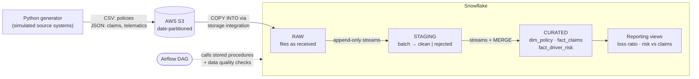
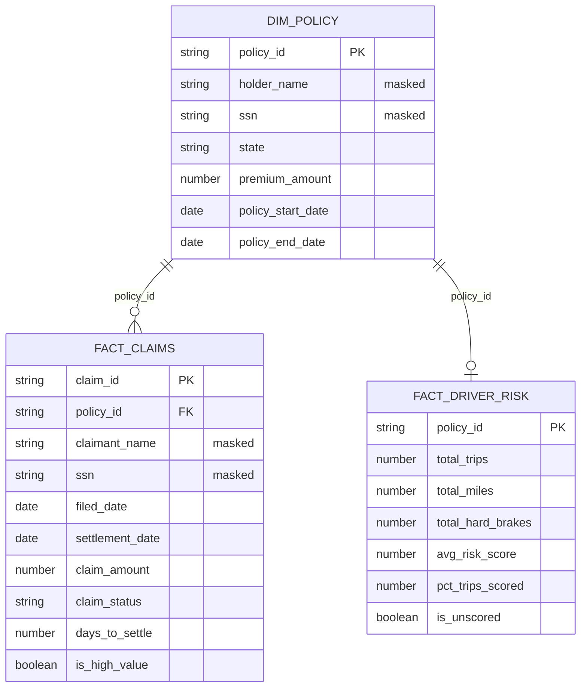
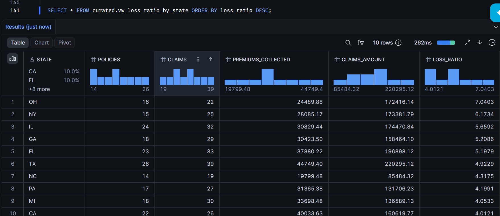
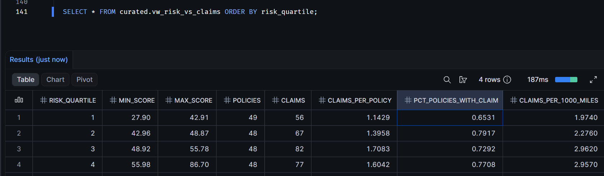
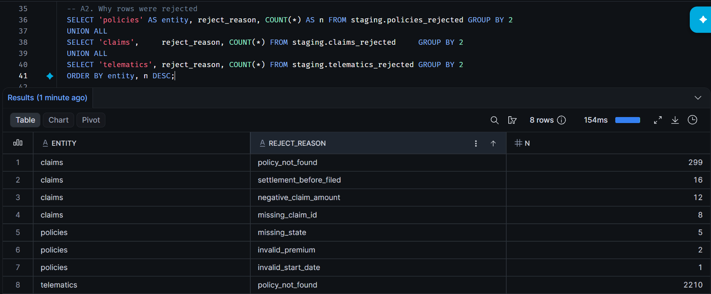
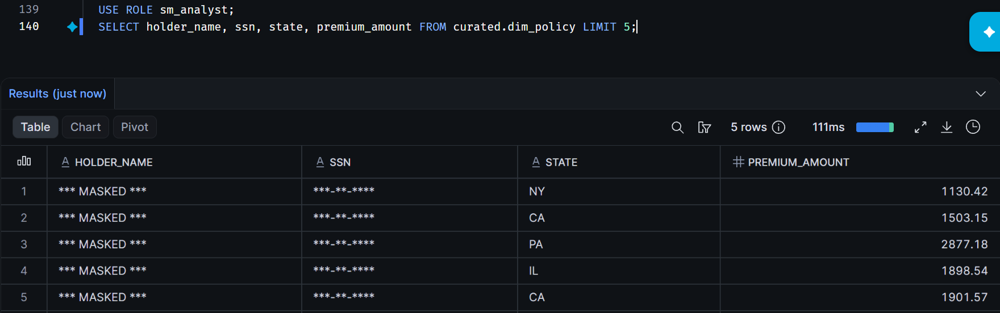
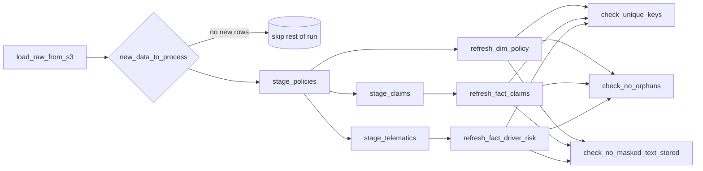
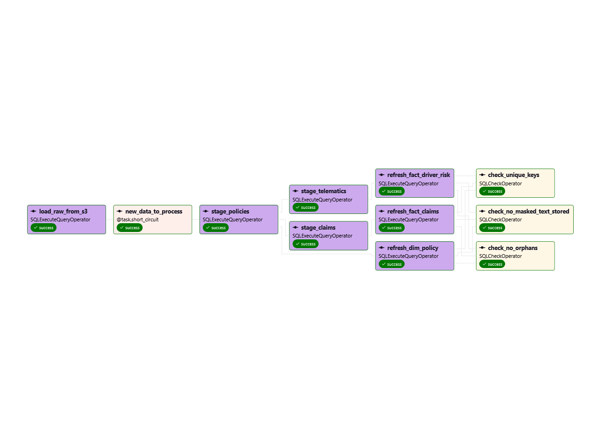
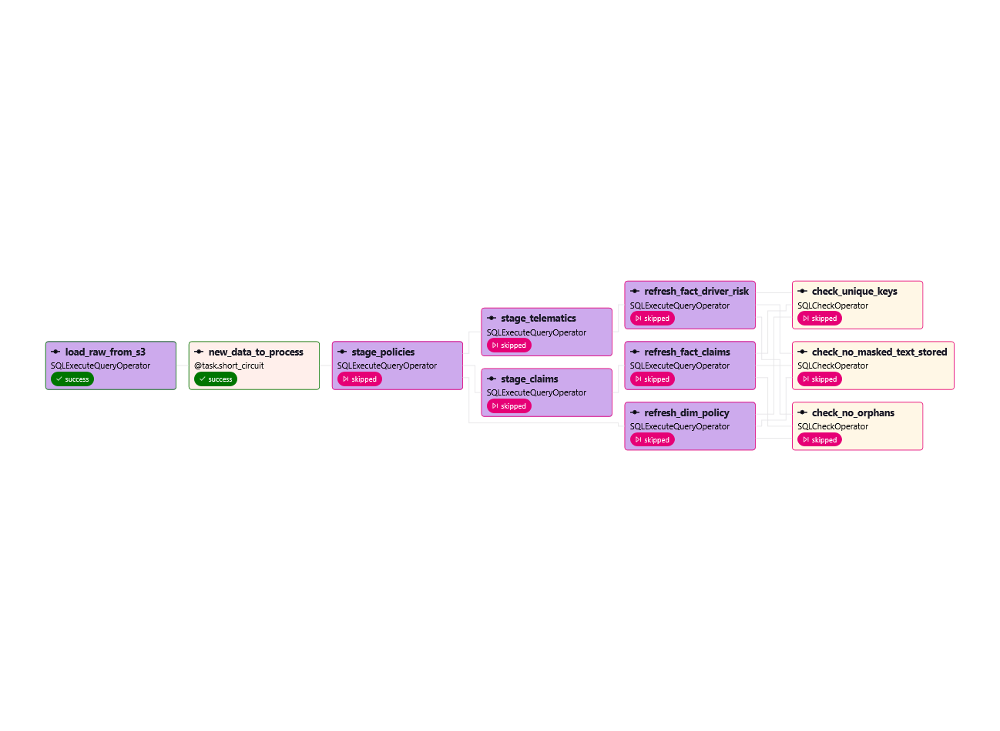
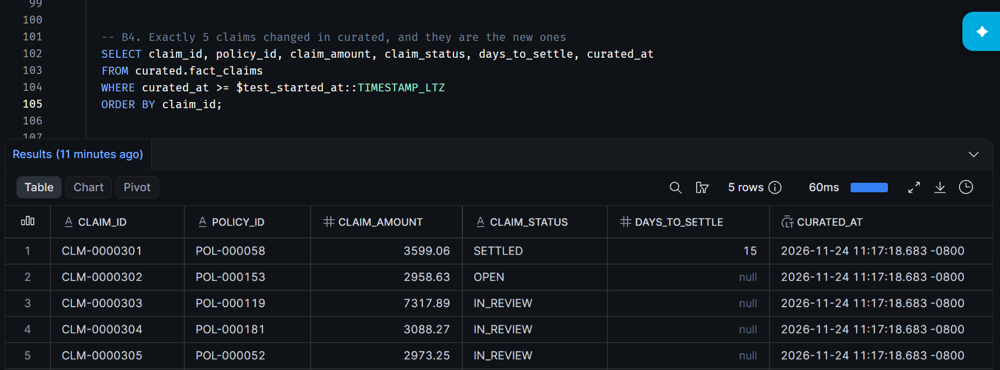

# Sentinal Motor — Incremental Insurance Data Pipeline

An end-to-end data pipeline for a simulated motor insurer. Policy, claim and vehicle telematics files land in **AWS S3**, are loaded into **Snowflake**, validated and deduplicated in a staging layer, and published as a star schema for loss-ratio and driver-risk reporting. **Apache Airflow** orchestrates the run, and **Snowflake Streams** make every step incremental: each run processes only the records that arrived since the last one.


> All data is synthetic. Names and SSNs are generated; SSNs use the 900–999 range, which is never issued.

---

## Architecture



| Layer | Holds | Refreshed by |
|---|---|---|
| **RAW** | Files exactly as received. CSV columns kept as `STRING` so bad values still land; JSON kept as `VARIANT`. Each row records its source file and row number. | `COPY INTO` (already-loaded files are skipped) |
| **STAGING** | Typed and validated rows. Failures go to `*_rejected` with a reason; valid rows are deduplicated into `*_clean`. | Stored procedure per entity, reading the raw stream inside one transaction |
| **CURATED** | Star schema with derived metrics, plus reporting views | `MERGE` from streams on the staging tables |

## What it demonstrates

- **Incremental processing (CDC).** Append-only streams on raw tables and standard streams on staging tables pass only new or changed rows downstream. Curated tables are updated with `MERGE`, never rebuilt.
- **Data quality and quarantine.** Row rules (missing keys, unparseable dates and amounts, negative amounts, settlement before filing) and referential integrity (claims and trips must reference a valid policy). Rejected rows are kept with a reason code; PII is stripped from the stored record.
- **Atomic, retry-safe runs.** Each staging procedure runs in one transaction. If anything fails, it rolls back and the stream keeps its rows for the next run.
- **Dimensional modelling.** `dim_policy`, `fact_claims` (days to settle, high-value flag) and `fact_driver_risk` (trip aggregates per policy, updated by recomputing only the policies that received new trips).
- **Column-level security.** Tag-based masking of names and SSNs across every layer: analysts see masked values, fraud analysts see the last four digits, and the pipeline role sees real values so it never copies masked text into a table.
- **Least-privilege access.** Access roles and functional roles, a dedicated pipeline role, an Airflow service user with key-pair authentication only, and an S3 storage integration that assumes an IAM role, so no AWS keys are stored in Snowflake.
- **Orchestration.** An Airflow DAG that skips the run when no stream has new data, enforces load order (policies before claims and trips), and fails loudly on data quality checks.

## Data model



**Reporting views**

- `vw_loss_ratio_by_state`: claims amount ÷ premium by state. Claims are aggregated per policy before joining, so premium is never double-counted.
- `vw_risk_vs_claims`: policies split into risk-score quartiles (`NTILE(4)`) with claim frequency per quartile, per policy and per 1,000 miles, to test whether telematics predicts claims.
- `vw_fact_claims`: adds `claim_age_days` for open claims. It is a view because a stored value would be wrong the next day.

| Loss ratio by state | Claim frequency by risk quartile |
|---|---|
|  |  |

## Data quality and security

Invalid records are quarantined with a reason code rather than dropped. The generator deliberately produces about 5% bad records (orphan policy IDs, invalid dates, negative amounts, duplicates) to exercise these rules.



Names and SSNs are masked by one tag-based policy wherever they appear. An analyst sees business columns in full and PII masked:



| Role | Name | SSN |
|---|---|---|
| `sm_analyst`, `sm_data_engineer` | `*** MASKED ***` | `***-**-****` |
| `sm_fraud_analyst` | real value | `XXX-XX-1234` |
| `sm_pipeline` | real value | real value (needed to move data between layers) |

## Pipeline run



**A run with new data:** every task completes and all three quality checks pass.



**A run with no new data:** the pipeline stops early and changes nothing.



## Incremental behaviour: verified

Five new claims were generated and uploaded after the initial load, then the DAG was triggered.

| Check | Result |
|---|---|
| Files loaded by `COPY` | 1 (the new file, 5 rows). All earlier files skipped |
| `fact_claims` rows | 277 → **282** |
| Policies / driver-risk rows touched | **0 / 0** |
| New rejected rows | **0** |
| Second run with no new files | Stopped at `new_data_to_process`; nothing changed |

The queries are in [`snowflake/05_verification.sql`](snowflake/05_verification.sql).



## Repository structure

```
├── generator/                 Python source-system simulator (writes CSV/JSON to S3)
├── aws/iam/                   IAM policies: generator user, Snowflake read role, trust policy
├── snowflake/
│   ├── 00_account_setup.sql   database, schemas, storage integration, stage, file formats
│   ├── 01_governance.sql      roles, grants, PII tag, masking policy
│   ├── 02_pipeline_objects.sql tables, streams, stored procedures, views, tags
│   ├── 03_pipeline_role.sql   pipeline role grants and Airflow service user
│   ├── 04_first_run.sql       first manual run, in order
│   └── 05_verification.sql    layer counts, reject reasons, incremental test
├── airflow/                   Astro project: DAG, requirements, connection template
└── docs/
    ├── design-decisions.md    why the pipeline is built the way it is
    └── lessons-learned.md     problems hit while building it, and their fixes
```

## Running it

**Prerequisites:** a Snowflake account (Enterprise edition or trial, for masking policies), an AWS account, Python 3.10+, Docker Desktop and the [Astro CLI](https://www.astronomer.io/docs/astro/cli/install-cli).

1. **AWS.** Create an S3 bucket in the same region as your Snowflake account. Create an IAM user for the generator with [`generator-user-policy.json`](aws/iam/generator-user-policy.json), and an IAM role for Snowflake with [`snowflake-read-policy.json`](aws/iam/snowflake-read-policy.json).
2. **Snowflake setup.** Run `00_account_setup.sql`, then put the integration's IAM user ARN and external ID into the role's trust policy ([template](aws/iam/snowflake-trust-policy.example.json)). Run `01_governance.sql`, `02_pipeline_objects.sql` and `03_pipeline_role.sql`.
3. **Generate data.**
   ```bash
   cd generator
   pip install -r requirements.txt
   python generate_data.py init --bucket <bucket> --profile <aws-profile>
   ```
4. **First run.** Run `04_first_run.sql`, then section A of `05_verification.sql`.
5. **Airflow.** Create a key pair, set the public key on the service user (in `03_pipeline_role.sql`), copy `airflow/airflow_settings.example.yaml` to `airflow_settings.yaml`, fill it in, place the private key at `airflow/include/keys/rsa_key.p8`, then:
   ```bash
   cd airflow
   astro dev start
   ```
   Open http://localhost:8080, unpause `sentinal_motor_pipeline` and trigger it.
6. **Incremental test.**
   ```bash
   python generate_data.py incremental --claims 5 --clean --bucket <bucket> --profile <aws-profile>
   ```
   Trigger the DAG and run section B of `05_verification.sql`.

## Design decisions and lessons learned

- [Design decisions](docs/design-decisions.md): MERGE instead of rebuilds, excluding missing risk scores instead of defaulting them, why the pipeline has its own masking branch, and others.
- [Lessons learned](docs/lessons-learned.md): real problems hit while building this, such as orphan claims, masked values leaking into tables, streams created after the data, and silently kept file format settings.

## Possible next steps

- Reprocess `policy_not_found` claims when a late-arriving policy is loaded
- Slowly changing dimension (SCD Type 2) history for `dim_policy`
- Dev → QA → Prod promotion with CI/CD (for example schemachange and GitHub Actions)
- Snowpipe auto-ingest for the telematics feed
